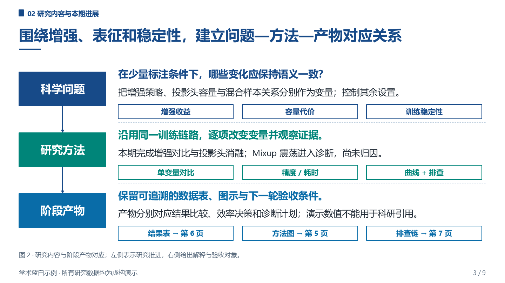
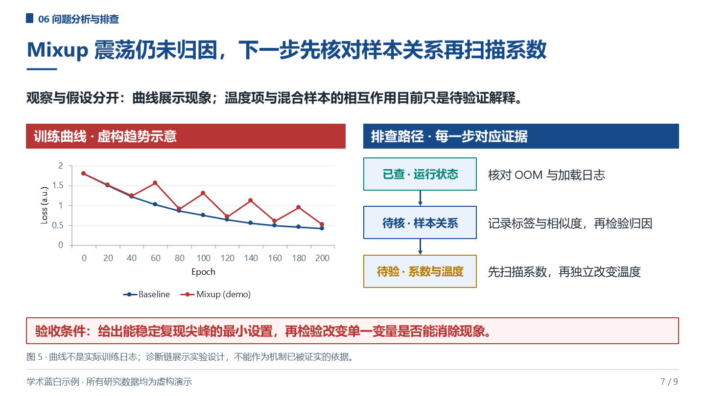

<div align="center">

# Academic PPT

**Editable academic PowerPoint decks with substantive content and explanatory figures.**

Formerly Lyceum. The `lyceum` skill name and installation path remain compatible.

[English](README.md) · [简体中文](README.zh-CN.md) · [MIT](LICENSE)

</div>

## Default: academic white and blue

White canvas, deep-blue headers, dark body text, fine outlines, and named stage colors.
Each page completes a research task by connecting its question, method, evidence, and interpretation.
Six scenario playbooks supply the argument structure; their 18 older themes remain optional.

The default compositions are:

- **Technical route:** question → data → method → validation → output, with stage explanations below.
- **Process and explanation:** a left-hand question/method/output sequence aligned with substantive text.
- **Background to research question:** task evidence or a case on the left, the resulting gap on the right.
- **Methods and evidence:** native architecture diagrams, data flows, charts, diagnostic curves, tables, and schedules.

Related findings can share a page. There is no blanket eight-line limit or automatic split for
multiple subclaims. Plan useful information units and a main figure before building; adapt density
to the audience and available evidence. Missing results stay missing rather than becoming invented data.

See the shared [design and density contract](skills/lyceum/references/academic-blue.md).
User references and institutional templates take precedence.

## Editable nine-slide example

Topic: contrastive learning for few-shot classification. **All experimental values and curves are
fictional demonstrations**, labeled in slide footers and notes.

| Background → question | Process + explanation | Technical route |
|---|---|---|
|  |  |  |
| Method architecture | Results and table | Curve and diagnosis |
|  |  |  |

[Download PPTX](examples/group-meeting-demo/group-meeting-demo.pptx) ·
[Build script](examples/group-meeting-demo/build_demo.js) ·
[All slide previews](examples/group-meeting-demo/render/)

Text, diagram nodes, connectors, charts, and tables remain native PowerPoint objects.
Chart data is embedded in workbooks and recorded in the corresponding slide notes.

## Six academic scenarios

| Scenario | Typical talk | Playbook |
|---|---|---|
| Lab group meeting / 组会 | 15–40 min | [group-meeting.md](skills/lyceum/references/group-meeting.md) |
| Conference talk / 学术会议 | 12–20 min | [conference.md](skills/lyceum/references/conference.md) |
| Progress, mid-term, final / 科研进展 | 15–30 min | [progress.md](skills/lyceum/references/progress.md) |
| Thesis defense / 学位答辩 | 15–40 min | [defense.md](skills/lyceum/references/defense.md) |
| Research proposal / 开题 | 10–20 min | [proposal.md](skills/lyceum/references/proposal.md) |
| Paper reading / Journal Club | 20–45 min | [paper-reading.md](skills/lyceum/references/paper-reading.md) |

Read the scenario for research structure, then the shared academic-blue contract for visuals.
Choose a named legacy theme explicitly when wanted.

## Install the skill

```bash
git clone https://github.com/XiaoMa-77/academic-ppt.git
cd academic-ppt

# Claude Code
mkdir -p ~/.claude/skills
cp -r skills/lyceum ~/.claude/skills/

# Agents supporting .agents/skills
mkdir -p ~/.agents/skills
cp -r skills/lyceum ~/.agents/skills/
```

Windows PowerShell:

```powershell
New-Item -ItemType Directory -Force "$env:USERPROFILE/.agents/skills" | Out-Null
Copy-Item -Recurse skills/lyceum "$env:USERPROFILE/.agents/skills/"
```

Example request:

```text
Use Lyceum to build an academic-blue research proposal from my materials.
Keep the problem, method details, and explanatory figures together.
Use a horizontal technical route and a process/explanation layout.
Use the supplied experimental values for charts.
```

## Build and check

Requires Node.js 22+ and Python 3.10+. Run from the repository root:

```bash
npm ci
python -m pip install -r requirements-qa.txt
npm run build
npm run qa
npm test
```

`build` generates the example and normalizes redundant paragraph properties from PptxGenJS
while retaining rich text and native objects. `qa` checks text geometry, placeholders, fonts,
editability, negative extents, known XML faults, and optional academic-density hints.
`test` runs 13 behavioral regressions, including the original deliberately defective fixture.
GitHub Actions rebuilds the deck, runs QA and tests, and uploads the generated PPTX.

For a different output path:

```bash
node examples/group-meeting-demo/build_demo.js /path/to/output.pptx
```

Set `PYTHON` to a different Python interpreter if needed. The lockfile pins build dependencies;
an image-size override selects the patched parser version.

## Render and inspect

With PowerPoint installed on Windows:

```powershell
./skills/lyceum/scripts/render_powerpoint.ps1 `
  -DeckPath examples/group-meeting-demo/group-meeting-demo.pptx `
  -OutDir examples/group-meeting-demo/render
```

The script opens the deck read-only and exports every page at 1440×810. Open/export failures
stop the script. Other platforms can render through LibreOffice and `pdftoppm`; install CJK fonts.

QA is heuristic. Inspect every rendered page for text fit, labels, arrows, punctuation,
chart readability, and factual support. `--academic` reports diagram candidates based on
shapes and lines; it does not establish scientific meaning or truth.

## Repository layout

```text
skills/lyceum/
  SKILL.md                        # Routing, research content, native-object contract
  references/academic-blue.md     # Default design, density, and figure planning
  references/                    # Six scenario playbooks and optional legacy themes
  scripts/qa_check.py             # Programmatic QA and content hints
  scripts/normalize_pptx.py       # Generated DrawingML compatibility pass
  scripts/render_powerpoint.ps1   # Native Windows open and render check
examples/group-meeting-demo/      # Nine-slide deck, builder, all page previews
examples/qa-selftest/             # Negative fixture and regressions
.github/workflows/quality.yml     # Build and test automation
```

For contributions, include concrete research tasks and figure plans. Rebuild, check, render,
and inspect changed examples. Keep the skill entrypoint concise and detailed rules in references.

[MIT](LICENSE) © 2026 Lyceum contributors.
