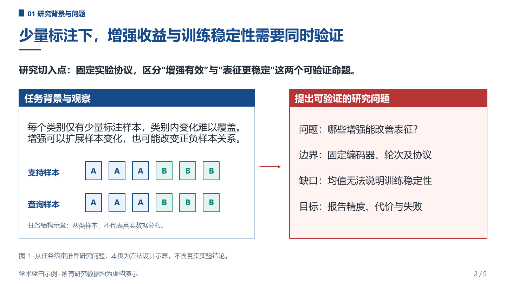
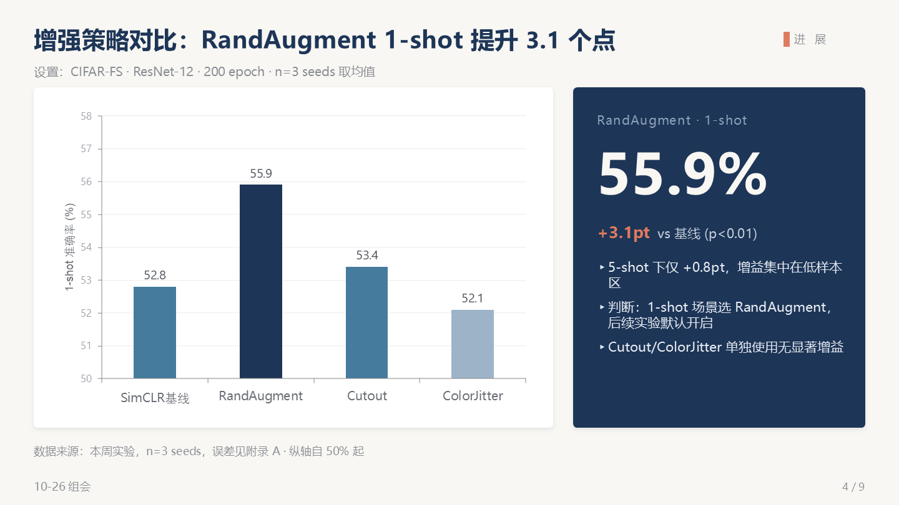
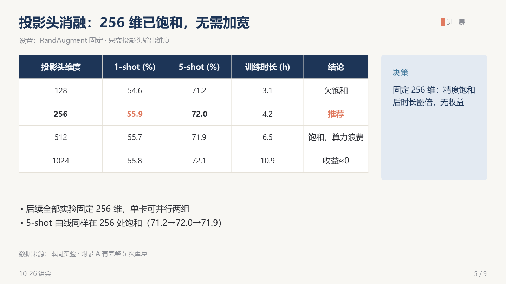
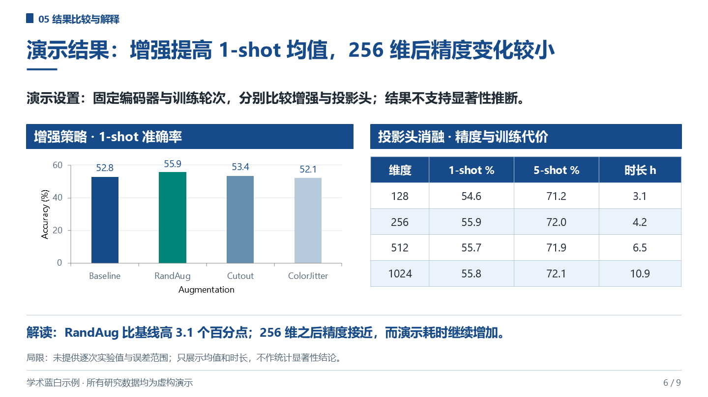
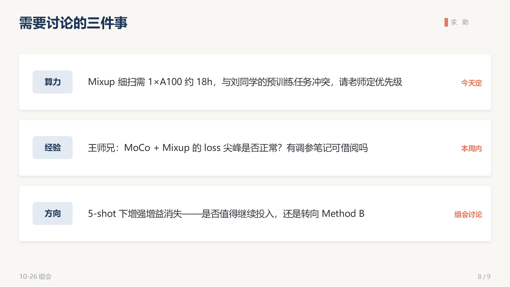

<div align="center">

# Lyceum · 吕克昂

**学术汇报引擎 —— 为 AI 编程代理打造的六套研究生级演示系统。**

*名字取自亚里士多德创立的吕克昂学园——学者们边散步边讲学之地。
此后每一次组会、答辩与会议报告，都是吕克昂的回声。*

[](LICENSE)
[](https://code.claude.com/docs/skills)
[](#设计亮点)
[](skills/lyceum/scripts/qa_check.py)

[English](README.md) · [简体中文](README.zh-CN.md)

</div>

---

## Lyceum 是什么

Lyceum 是一个开源的 [agent skill](https://code.claude.com/docs/skills)（`SKILL.md` 技能包），
教会 Claude Code、ZCode、Codex CLI 或任何兼容 SKILL.md 的智能体生成与编辑
**在 PowerPoint 中保持原生可编辑的学术汇报幻灯片**——真实的文本框、真实的图表
（右键"编辑数据"即可改）、真实的表格与形状。

它不是"一个模板换个颜色"。它内置**六套完整的场景系统**，每套都有自己的页面骨架、
设计令牌、内容方法论与主题变体——因为组会和答辩是两种不同的文体，不是同一份 PPT
换配色：

| 场景 | 时长 | 页数 | 规范文件 |
|---|---|---|---|
| 组会汇报 | 15–40 分钟 | 8–20 | [`references/group-meeting.md`](skills/lyceum/references/group-meeting.md) |
| 学术会议报告 | 12–20 分钟 | 12–18 | [`references/conference.md`](skills/lyceum/references/conference.md) |
| 科研进展·中期·结题 | 15–30 分钟 | 12–25 | [`references/progress.md`](skills/lyceum/references/progress.md) |
| 学位论文答辩 | 15–40 分钟 | 20–40 | [`references/defense.md`](skills/lyceum/references/defense.md) |
| 开题报告 | 10–20 分钟 | 15–25 | [`references/proposal.md`](skills/lyceum/references/proposal.md) |
| 文献分享 / Journal Club | 20–45 分钟 | 12–25 | [`references/paper-reading.md`](skills/lyceum/references/paper-reading.md) |

每个场景附 **3 套主题变体**（共 18 套设计系统），全部基于五层视觉模型——纸感页面、
内容卡片、色阶墨系、唯一强调色、深色封面三明治——外加中英文**分 run 排版规则**，
让数字不再像"顺手打出来的"。

## 效果示例

由 Lyceum 生成的 9 页组会汇报（主题 *研纸墨蓝*，研究内容为虚构演示数据）：

| | | |
|---|---|---|
|  |  |  |
| 墨蓝深底封面 · 周次索引卡 | 纸感页面 · 证据卡片 | 原生色阶柱状图 |
|  |  |  |
| 原生表格 + 决策面板 | 2×2 问题分析页 | 有归属人的具体求助 |

完整文件：[`examples/group-meeting-demo/group-meeting-demo.pptx`](examples/group-meeting-demo/group-meeting-demo.pptx) ·
生成脚本：[`build_demo.js`](examples/group-meeting-demo/build_demo.js)

## 设计亮点

Lyceum 自身提供的能力：

- **六套学术场景系统**——组会、开题、答辩、论文精读、课程报告、进展汇报，
  每套配三个完整设计主题。
- **程序化 QA 闸门**——每次构建自动审计溢出、重叠、占位符、字体与可编辑性，
  通过 QA 的幻灯片无需逐页目检即可交付。
- **原生可编辑输出**——图表是真图表、表格是真表格，不存在截图烘焙。
- **内置内容方法论**——行动式标题、幽灵放映测试、断言→证据映射，并分场景
  提供负结果与局限性的诚实表述指导。
- **中文学术排版**——中西文分 run 与标点规则在构造层处理。
- **可移植**——一份 SKILL.md 加两个普通依赖（`python-pptx`、`pptxgenjs`）；
  若智能体已装有官方 `pptx` skill，Lyceum 会把语法级执行委托给它，
  自身专注场景系统层（见 [`SKILL.md`](skills/lyceum/SKILL.md)）。

## 快速开始

前置要求：支持 SKILL.md 的智能体 + `python-pptx`（QA）+ `pptxgenjs`（构建）。

```bash
git clone https://github.com/<you>/lyceum.git

# Claude Code
mkdir -p ~/.claude/skills && cp -r lyceum/skills/lyceum ~/.claude/skills/

# ZCode / Codex CLI / 任何兼容 .agents 的智能体
mkdir -p ~/.agents/skills && cp -r lyceum/skills/lyceum ~/.agents/skills/

# 可选：QA 与构建依赖
pip install python-pptx && npm install -g pptxgenjs
```

然后直接对话即可：

```text
帮我准备下周三的组会PPT，主题是对比学习在小样本分类上的进展，
上周复现了基线，这周有增强策略对比和消融实验，另外Mixup有bug要讨论

用 Lyceum 做一份硕士答辩PPT框架，研究方向是联邦学习里的异构模型聚合，
创新点有三个，给我深一点的学院风配色

Journal club 分享这篇 NeurIPS 论文，重点讲方法和我觉得站不住的消融部分
```

技能自动路由：组会 / 答辩 / 开题 / 中期 / 结题 / 会议 / journal club 等关键词自动选择
场景系统；语义模糊时只问一个澄清问题，绝不瞎猜。

### QA 闸门

每份 deck 交付前过两道闸门：

```bash
python skills/lyceum/scripts/qa_check.py deck.pptx
# 检查：文本溢出（中西文宽度感知）· 形状越界 · 文本框重叠 · 占位符残留
#       字体覆盖 · 可编辑性审计
# 退出码 0=干净 · 1=有错误 · 2=仅警告 · --json 输出机器可读报告
```

外加渲染视觉审查。QA 脚本自带负向测试夹具（[`examples/qa-selftest/`](examples/qa-selftest/)）
——七个植入缺陷，七个全部捕获。

## 仓库结构

```text
lyceum/
├── skills/lyceum/
│   ├── SKILL.md                 # 路由 · 工作流 · 铁律 · 视觉系统 · QA 协议
│   ├── references/              # 6 套场景系统（骨架·令牌·模板·陷阱清单）
│   └── scripts/qa_check.py      # 程序化质量闸门
├── examples/
│   ├── group-meeting-demo/      # 9 页示例 deck + 生成脚本 + 渲染图
│   └── qa-selftest/             # 证明 QA 闸门有效的负向夹具
├── README.md · README.zh-CN.md · CHANGELOG.md · LICENSE
```

## 路线图

- [ ] 每套主题导出 `.potx` 母版，供 PowerPoint 原生复用
- [ ] 中英双栏双语模式（国际项目/留学生）
- [ ] `restyle` 规范：页面角色识别，把旧 deck 一键升级为 Lyceum 主题
- [ ] 更多场景：课程 seminar、学术海报（A0）、三分钟学术演讲

## 参与贡献

欢迎 Issue 与 PR——尤其是**新主题变体**（色板须通过五层视觉模型检验）与
**新场景**（须附真实页面骨架）。改动示例 deck 后请运行
`python skills/lyceum/scripts/qa_check.py`；SKILL.md 保持在 500 行以内
（深度内容放进 `references/`）。

## 许可

[MIT](LICENSE) © 2026 Lyceum 贡献者。示例 deck 中的研究数据均为虚构。

<div align="center">

*先研究透彻，再讲得明白。* —— 谨此致敬吕克昂

</div>
